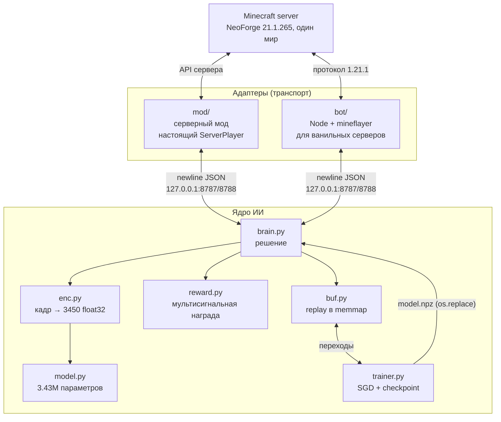

# SOMA — System One Minecraft Agent

Компактный самообучающийся агент для Minecraft. Не скрипт с заранее прописанными
сценариями, а небольшая decision-модель: она получает мир **числами**, выбирает
действие из списка допустимых кандидатов и учится на последствиях в **одном живом
мире**.

Агент существует на сервере как **настоящий игрок**: он в табе, мобы его видят и
бьют, он голодает, падает, разбивает ногу, подбирает дроп и умирает.

[](https://www.python.org/)
[](https://nodejs.org/)
[](https://openjdk.org/)
[]()
[]()
[](https://github.com/vovawees/soma)

---

## Содержание

- [Что уже работает](#что-уже-работает)
- [Архитектура](#архитектура)
- [Два адаптера, один мозг](#два-адаптера-один-мозг)
- [Структура проекта](#структура-проекта)
- [Наблюдение](#наблюдение)
- [Действия](#действия)
- [Модель и обучение](#модель-и-обучение)
- [Протокол](#протокол)
- [Быстрый старт](#быстрый-старт)
- [Сборка мода](#сборка-мода)
- [Грабли](#грабли-десять-ловушек-которые-стоили-часов)
- [Чего пока нет](#чего-пока-нет)

---

## Что уже работает

| | |
|---|---|
| **Настоящий игрок** | в табе, `players=1`, другие игроки его видят |
| **Мобы агрит** | зомби и криперы выбирают его целью, удары проходят |
| **Урон** | 20 → 19.03 от удара зомби, урон от падения, лавы, голода |
| **Сурвайвал** | `GameType.SURVIVAL`, голод, сытость, реген, падение, лава, смерть и возрождение |
| **Добыча** | прогрессивная, зависит от инструмента: железо без кирки не берётся |
| **Свой A\*** | обход стен, ям и препятствий (у игроков в ванилле `getNavigation()` нет — это фича мобов) |
| **Плавание** | buoyancy, `setSwimming()`, агент всплывает и гребёт |
| **Сбор лута** | нативный pickup, как у обычного игрока |
| **Стоимость кадра** | 1.6–2.7 мс, < 1% одного ядра сервера |
| **RAM агента** | brain 120 МБ + trainer 96 МБ |
| **Сборка** | `javac` без Gradle — прямо против библиотек сервера |

## Архитектура



Один мир, один агент, никаких параллельных вселенных ради ускорения сбора опыта.
Runtime и Training Engine изолированы от игрового потока: сервер не ждёт ИИ ни
в одном тике.

## Два адаптера, один мозг

| Адаптер | Для чего | Нужен на сервере? |
|---|---|---|
| `bot/` (Node + mineflayer) | ванильные серверы, портативность | нет, это обычный клиент |
| `mod/` (NeoForge-мод) | серверы с модами: NeoForge 21.1 отбивает ванильных клиентов на логине | да, `mods/soma-0.1.0.jar` |

Оба говорят на **одном и том же** протоколе, поэтому `agent/` не знает, кто
прислал кадр.

## Структура проекта

```
soma/
├── agent/                     ИИ-ядро (Python + numpy, без torch)
│   ├── config.py              размеры, гиперпараметры, пути
│   ├── enc.py                 кадр мира → плоский вектор
│   ├── model.py               модель + ручной backward
│   ├── buf.py                 replay buffer в memmap-файле
│   ├── reward.py              награда
│   ├── brain.py               главный цикл: кадр → решение → действие
│   ├── trainer.py             обучение, атомарная публикация весов
│   └── smoke.py               офлайн-проверка без сервера
├── mod/                       серверный мод (Java 21)
│   ├── src/main/java/ru/vovawe/soma/SomaMod.java
│   ├── src/main/resources/META-INF/neoforge.mods.toml
│   ├── build.sh               сборка javac без Gradle
│   └── build/soma-0.1.0.jar   готовый jar
├── bot/                       адаптер для ванильных серверов (Node)
├── scripts/
│   ├── soma.sh                жизненный цикл процессов (tmux)
│   ├── deploy_mod.sh          сборка → установка → рестарт сервера
│   ├── reset_training.sh      стереть модель и буфер
│   └── stats.sh               телеметрия
├── .ai/00-status.txt           полная техбаза: протокол, ловушки, статус
├── LOCAL_NOTES.md             как работать с локальной копией
└── README.md
```

## Наблюдение

Никаких скриншотов и никакого текстового промпта. Один кадр — плоский
float32-вектор, всё **относительно игрока** и повёрнуто в его систему координат
(инвариантность к переносу и повороту):

| Секция | Размер | Содержимое |
|---|---|---|
| `self` | 32 | скорость в локальной системе, yaw/pitch как sin/cos, hp/food/air/сытость, свет, флаги состояния, фаза суток, погода, измерение |
| `grid` | 512×6 | воксельное окно 8×8×8 с шагом 2 (±7 блоков): хэш-эмбеддинг блока + флаг «твёрдый» |
| `ent` | 12×10 | ближайшие сущности: тип, позиция (локально), дистанция, hp, класс опасности |
| `inv` | 41×4 | слоты: эмбеддинг предмета, количество, признак еды |
| `ev` | 10×5 | события: добыча, урон, смерть, атака, убийство, использование, падение, голод |
| `meta` | 12 | предыдущее действие, его длительность и успех, число кандидатов, награда |

Категориальные id идут через **фиксированные** хэш-эмбеддинги (4096 блоков,
2048 предметов, 1024 имени сущностей) — модпак на 248 модов не может сдвинуть
пространство признаков.

## Действия

Модель не генерирует текст и не выбирает из «сотен кнопок». Адаптер вычисляет
**допустимый список кандидатов** (≤48), агент отвечает **индексом**:

| Действие | Параметры | Кто исполняет |
|---|---|---|
| `goto` | x, y, z | A* + low-level контроллер (разгон, трение, прыжок) |
| `mine` | x, y, z | прогрессивная добыча с учётом инструмента |
| `attack` | entity id | ванильный урон оружием |
| `use` | x, y, z | верстак, печь, сундук, рычаг… |
| `place` | x, y, z | установка блока |
| `eat` | — | поесть из инвентаря |
| `drop`, `jump`, `wait`, `stop` | — | — |

Перед исполнением команда проверяется **повторно**: цель существует, в пределах
дотягивания, действие есть в списке кандидатов **того кадра**, из которого
мозг сделал выбор (индекс резолвится по `seq` кадра).

## Модель и обучение

```
frame(3450) ─encoder→ latent(192) ─┐
                                   ├─temporal(6 кадров)→ state(192) ─┬→ Q по кандидатам
frame(t+1) ─encoder (общие веса)──┘                                   ├→ V (ценность)
(latent_t, latent_{t+1}) ────────────────────────────────────────────┴→ aux dynamics
```

| | |
|---|---|
| Параметров | 3 428 097 (fp32, ~14 МБ) |
| Алгоритм | n-step Q-learning, factorised Q по кандидатам, target network, маски |
| Энкодер | обучается **только** на auxiliary-loss (предсказание следующего латента) |
| RL-лосс | идёт по detached латентам → обучение стабильное и дешёвое |
| Буфер | memmap на диске, 19 185 байт на переход, RAM не растёт с буфером |
| Публикация весов | `model.npz.tmp.<pid>` → `os.replace`, brain подхватывает по mtime |
| Reward | новый чанк/блок/предмет, убийство, урон, смерть, простой, стоимость времени |

## Протокол

Одна строка JSON в обе стороны, TCP.

```jsonc
// адаптер -> мозг
{"t":"obs","seq":412,"tick":2460,"self":{...},"grid":{"n":8,"step":2,"ids":[...]},
 "ent":[[id,dx,dy,dz,dist,hp,hostile],...],"inv":[[slot,item,count,is_food],...],
 "cand":[{"a":"mine","x":12,"y":64,"z":-3,"d":2.1},...],
 "ev":[{"e":"dig","m":1,"n":"stone"}],"prev":{"a":"goto","ticks":12,"ok":true}}

// мозг -> адаптер
{"t":"act","i":7,"s":412}     // индекс кандидата + seq кадра
```

## Быстрый старт

```bash
# мозг и обучение
python3 -m venv .venv && .venv/bin/pip install -r agent/requirements.txt
cd agent && SOMA_IPC_PORT=8788 ../.venv/bin/python brain.py     # решение
cd agent && ../.venv/bin/python trainer.py                       # обучение

# мод: сборка + установка + рестарт сервера
bash scripts/deploy_mod.sh

# в игре
/soma start | /soma stop | /soma status | /soma hurt N | /soma spawnmob | /soma cleanup
```

Чтобы крутить ИИ-часть локально, не перезапуская сервер:

```bash
ssh -L 8788:127.0.0.1:8788 <user>@<vps>
```

## Сборка мода

Собирается `javac` прямо против пропатченных классов Minecraft из `libraries/`
сервера — **без Gradle и ModDevGradle**.

```bash
MC_DIR=/path/to/neoforge-server bash mod/build.sh
```

Нужен JDK 21.

## Грабли: десять ловушек, которые стоили часов

Полный список — в [`.ai/00-status.txt`](.ai/00-status.txt). Самая дорогая:

> **`FakePlayer` не тикает.** `Entity.tickCount` навсегда остаётся 0, а
> `Entity.isRemovedOrRecentlyCreated()` — это `tickCount == 0`.
> `LivingEntity.hurt()` отбрасывает **весь** урон «недавно созданной» сущности.
> Мобы выбирают цель, бьют — и ничего не происходит. Лечится вызовом
> `player.baseTick()` каждый тик.

Остальные: `Entity.setInvulnerable()` ≠ `Abilities.invulnerable`; `placeNewPlayer`
перечитывает NBT с диска; `np.savez` дописывает `.npz`; промежуточные jar'ы в
`libraries/` перекрывают маппированные классы; `Entity.fallDistance` двигается
только внутри `LivingEntity.travel()`; индекс действия резолвится по `seq` кадра.

## Чего пока нет

- **Крафт** — главный блокер: без него агент не сделает каменную кирку и упирается
  в потолок по добыче
- генератор целей и внешняя память мира
- шифт-крафт, лук/стрелы, постройки
- INT8/INT4 рантайм, калибровка reward
- policy пока случайная: модель копит опыт, но ещё не «умеет играть»

---

## Лицензия

MIT. Код можно брать и дорабатывать — это было бы приятно.
